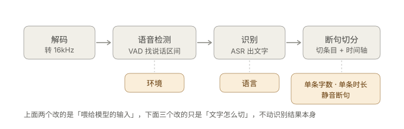
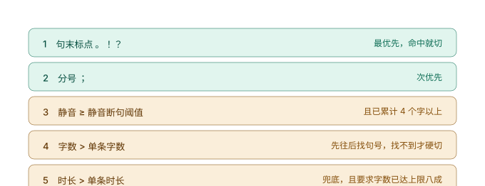

# 识别参数说明

界面左下角「识别参数」面板里有五个可调项。它们分属**三个不同的处理环节**，混在一起容易误以为是"识别质量调节"——实际上只有前两个会改变识别到的内容，后三个纯粹决定文字怎么切。

---

## 语言

**默认**：自动检测　**作用点**：识别（ASR）

直接传给 SenseVoice 的语言提示。模型是多语种混合训练的，你明确告诉它"这是中文"，它就不会把中文听成日文或粤语。

`自动检测` 让模型自己判断，绝大多数情况够用。但如果你的素材是**中英混杂**，或者说话带口音被识别成别的语种（表现为长段乱码、冒出假名或韩文），手动指定语言通常立刻正常。

可选值：自动检测 / 中文（普通话）/ 英文 / 中英混合 / 日语 / 韩语 / 粤语。

---

## 环境

**默认**：安静室内　**作用点**：语音检测（VAD）

这个不是"降噪开关"。它改的是 VAD 判定语音的三组阈值：

| 选项 | 判定"开始说话"的音量 | 认为"这句说完了"的静音 | 单段最长 |
| --- | --- | --- | --- |
| 安静室内（默认） | -30 dB | 350 ms | 30 s |
| 会议 / 访谈 | -32 dB（更灵敏） | 250 ms | 20 s |
| 嘈杂户外 | -24 dB（更迟钝，防噪声误触发） | 500 ms | 30 s |
| 快速对话 | -30 dB | 200 ms（接话快，不易被切断） | 15 s |
| 课堂 / 讲座 | -30 dB | 400 ms | 30 s |

选错的典型症状：

- 户外录音用「安静室内」→ 风声、键盘声也被当成说话，识别出一堆幻觉文字
- 安静环境用「嘈杂户外」→ 小声说话的开头被吞掉

---

## 断句三参数

这三个都在断句阶段生效，但**它们的生效顺序是有优先级的**，先命中者即在此处切分：

### 单条字数

**默认**：18 字

一条字幕最多多长。

注意它量的是"视觉宽度"：一个汉字算 1，一个英文字母算 **0.5**；而且当文本里 ASCII 占比超过 70%（纯英文）时，程序会自动把上限**翻倍到 36**，避免英文被切碎。所以英文素材不用动这个值。

### 单条时长

**默认**：6 秒

纯兜底。它还有个额外条件：字数必须已达到上限的 **80%** 才允许按时间切。

这是为了防止模型时间戳失真时把句子切得粉碎——时间戳说 8 秒、实际只识别出 3 个字，按时间切就废了。

### 静音断句

**默认**：0.6 秒

句子里停顿超过这个长度，就在那儿断一条。

这是最影响观感的一个值：调到 0.3 会觉得每句话都被拦腰砍断，调到 1.5 又会出现一条字幕挂十几秒。

另外它有个下限保护：累计宽度不足 4 个字时不会切，避免把"大家好，"这种短句单独切成一条。

---

## 实操：怎么调

绝大多数情况**只动前两个**，后三个用默认值就好。按症状对症下药：

| 症状 | 先调哪个 |
| --- | --- |
| 句子太碎，一句话切成三四条 | 静音断句 0.6 → 0.9 |
| 一条字幕太长，观众看不完 | 单条字数 18 → 14 |
| 字幕挂太久不换 | 单条时长 6 → 4 |
| 开头几个字丢了 | 环境换成「会议 / 访谈」（更灵敏） |
| 安静素材却识别出乱七八糟的字 | 环境别用「嘈杂户外」，改「安静室内」 |
| 冒出日文假名、韩文 | 语言手动指定「中文」 |

**按场景的推荐组合**：

| 场景 | 单条字数 | 单条时长 | 静音断句 |
| --- | --- | --- | --- |
| 口播短视频（字大、语速快） | 12～14 | 4 s | 0.5 s |
| 访谈、纪录片 | 18～22 | 6～8 s | 0.6～0.8 s |
| 课程讲座（说话慢、停顿多） | 18 | 8 s | 0.8～1.0 s |

---

## 附：参数在代码里的位置

想深究或改默认值，看这几处：

| 参数 | 取值定义 | 实际使用 |
| --- | --- | --- |
| 语言 | `src/subtitle_forge/ui/main_window.py` → `LANG_ITEMS` | `asr/sensevoice.py` → `_LANG_MAP` 映射后传给模型 |
| 环境 | 同上 → `ENV_ITEMS` | `core/vad.py` → `VadOptions.preset()` |
| 单条字数 / 时长 / 静音断句 | 同上 → `SplitOptions(...)` | `core/splitter.py` → `_find_cut()` 的 P2 / P5 / P6 分支 |
